# Diagrams

Twelve examples from [Pele’s published gallery](https://pele.run/examples) demonstrate different diagram families, layouts and notation. Each graphic is followed by ordinary selectable Markdown. Open the full gallery for the complete set.

## Flowchart

An application architecture with grouped clients, services and storage. Solid and dotted arrows distinguish the paths between components.

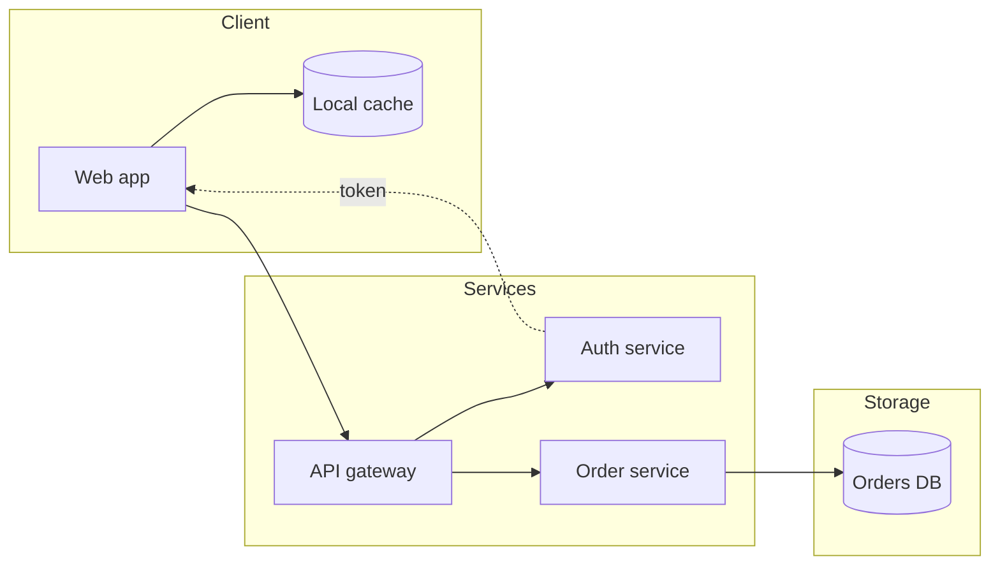

## Sequence

An order moves from customer to web app, API and bank. Numbered messages, an activation bar and a note show the stages of the exchange.

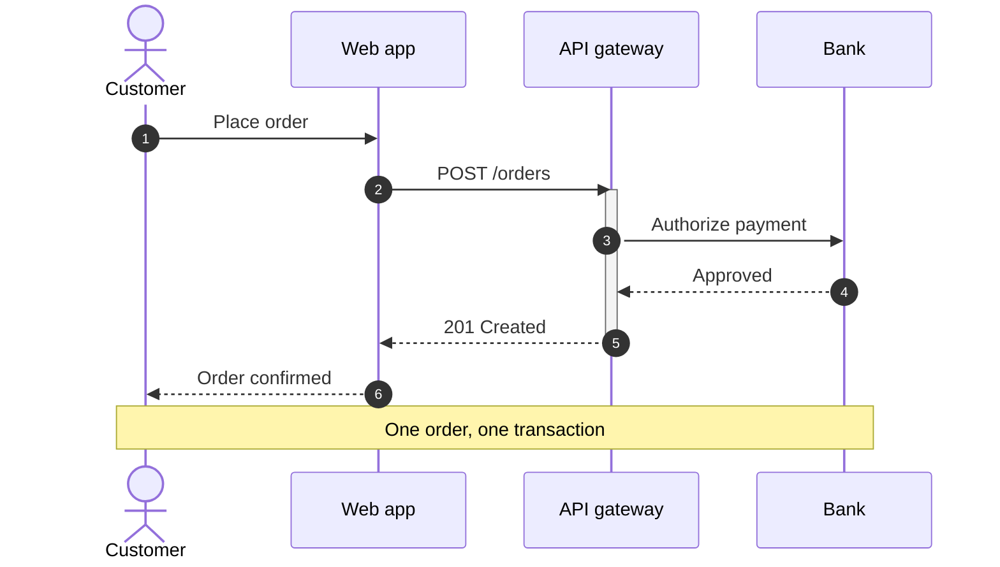

## Class

Nested namespaces organise a volcanic system. Classes expose methods, and labelled relationships connect the parts.

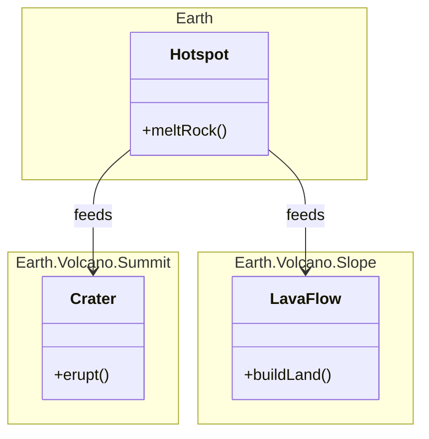

## Entity relationship

Cars, people and named drivers form a data model with primary, foreign and unique keys, typed fields and relationship cardinality.

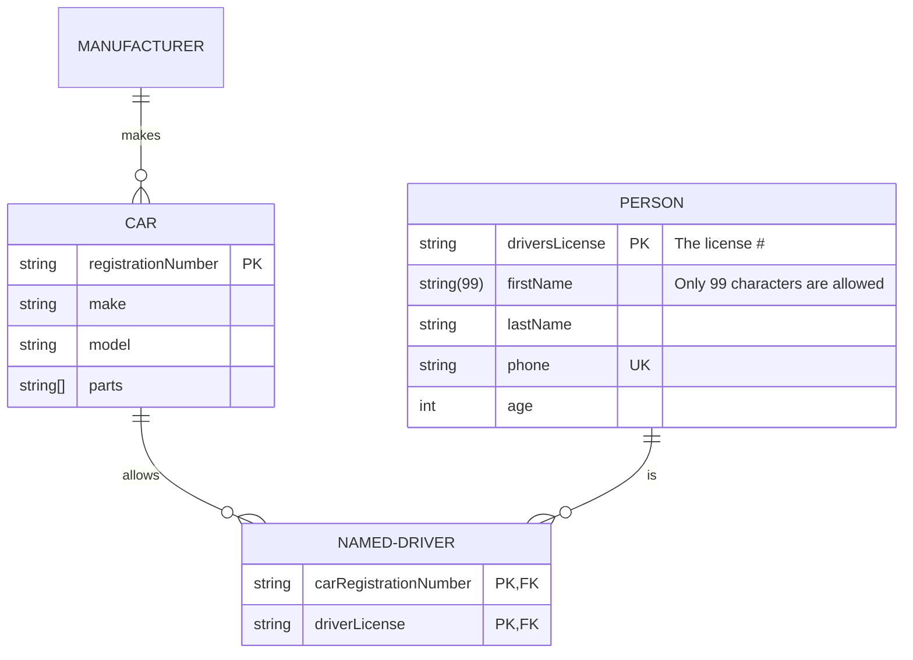

## State

A document progresses from draft to publication. A nested review state and labelled transitions show approval and rejection paths.

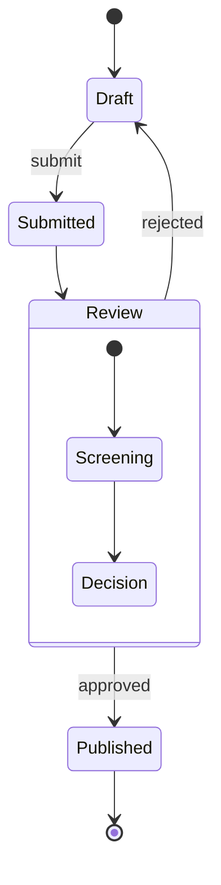

## Gantt

Task durations, calendar dates and a dependency appear on a shared timeline, grouped into project sections.

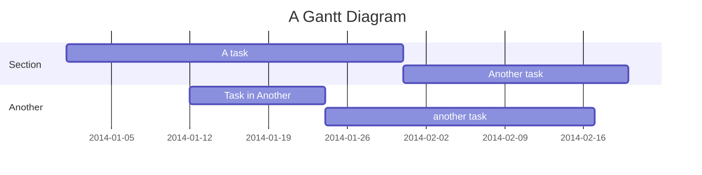

## Git graph

Branches diverge, merge and receive a cherry-picked commit. Explicit commit names make the resulting history easy to follow.

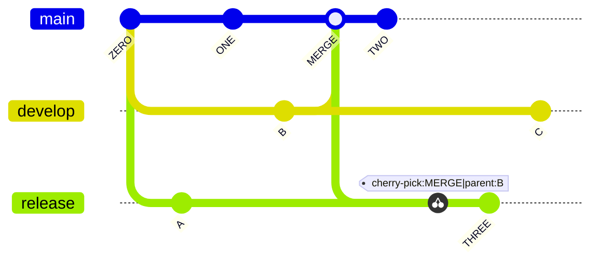

## Mindmap

A central topic branches into history, nature and culture. Nested labels demonstrate hierarchy, Unicode text and multiline content.

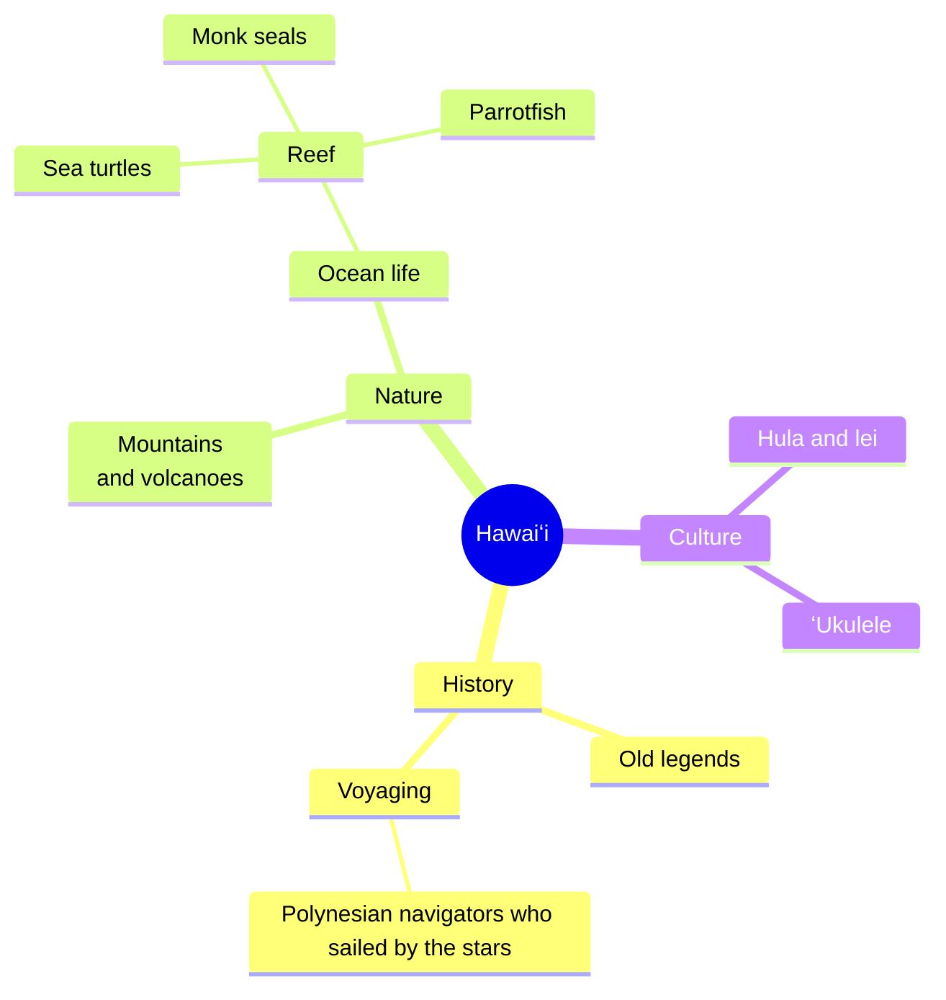

## Timeline

Sectioned events and multiple labels describe the Hawaiian islands in a chronological layout.

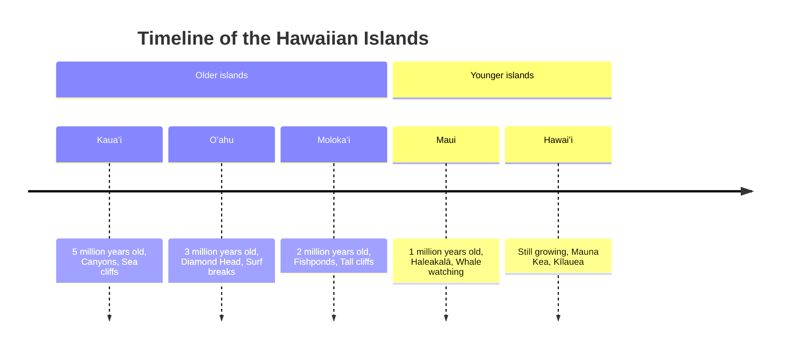

## User journey

A working day is split into phases. Each task includes a score and the people involved, adding an experience dimension to the sequence.

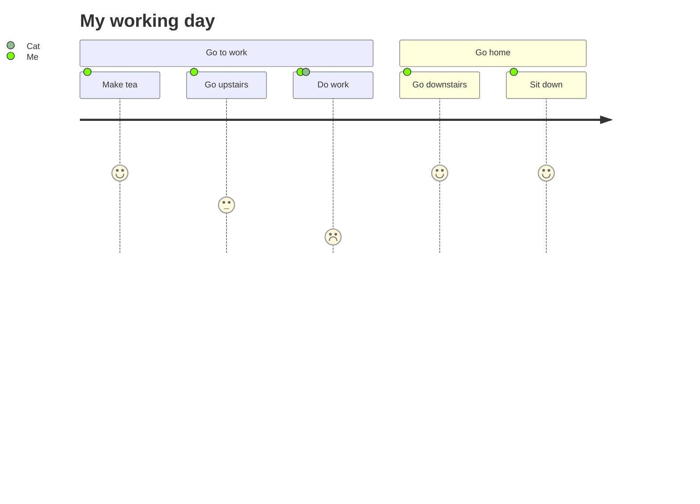

## Sankey

Flows from the electricity grid split into destinations. The width of each connection represents its numeric amount.

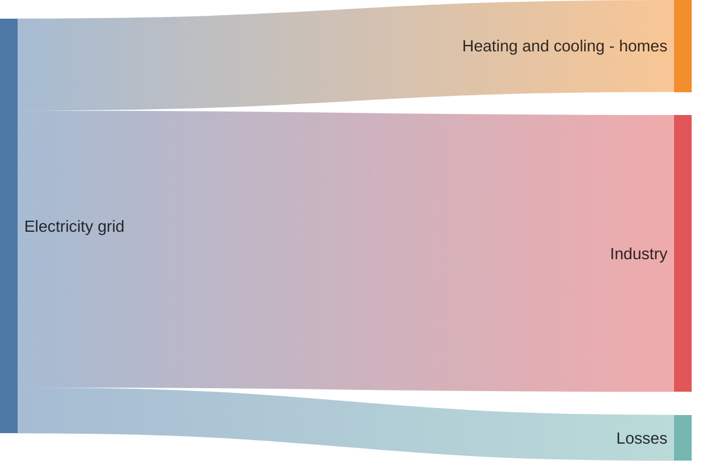

## Radar

Four restaurant profiles share the same labelled axes and scale, making their relative strengths visible in one graphic.

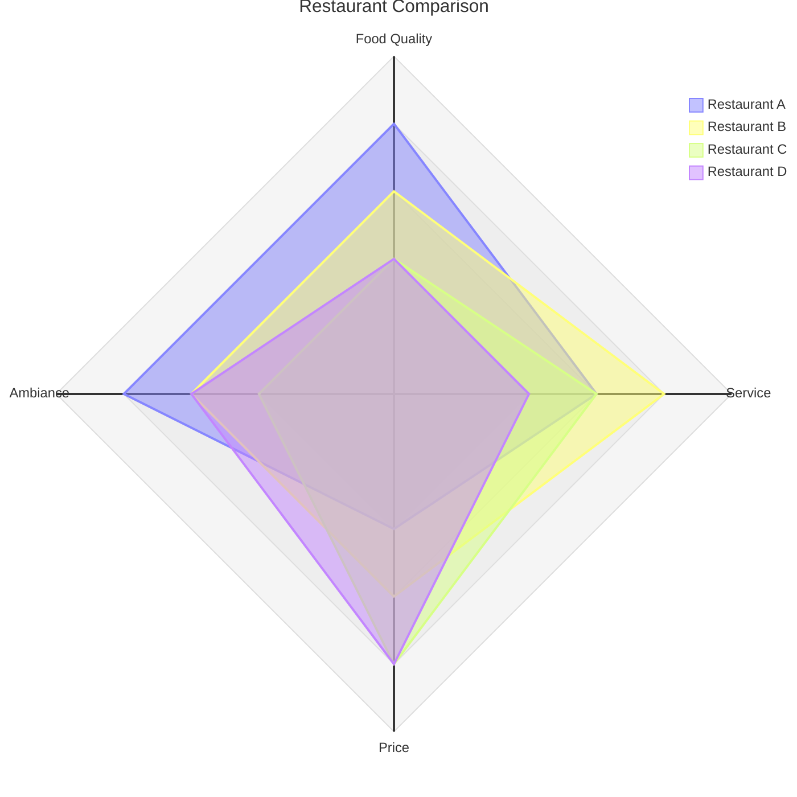

Try zooming a diagram, copying its source, and selecting text across the boundary between a paragraph and its graphic.
