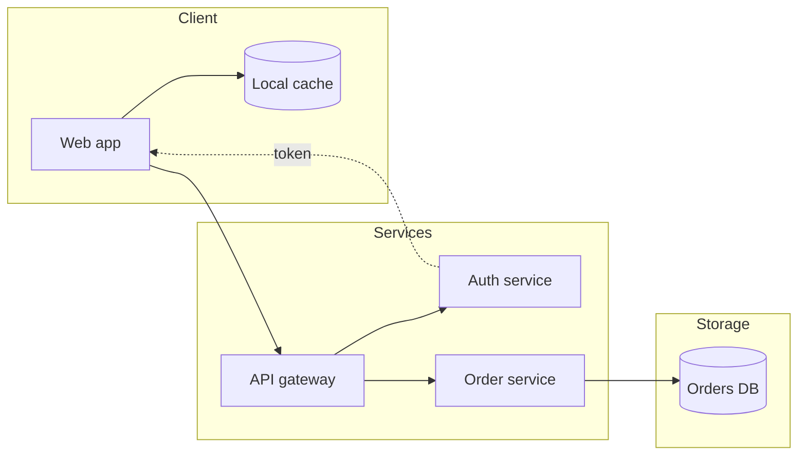
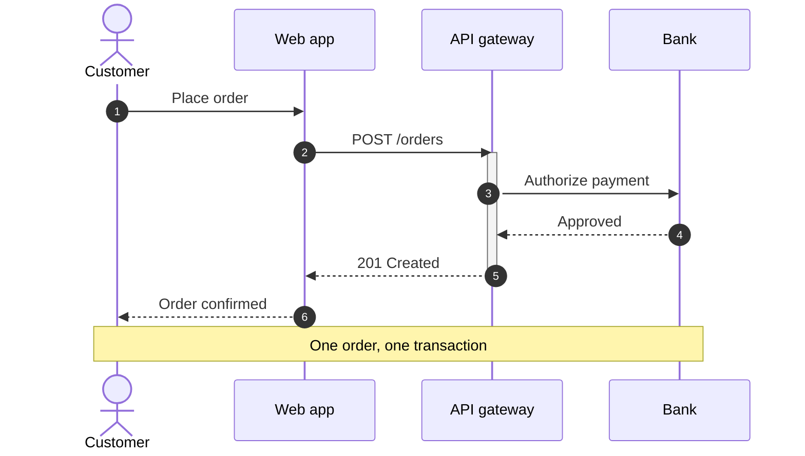
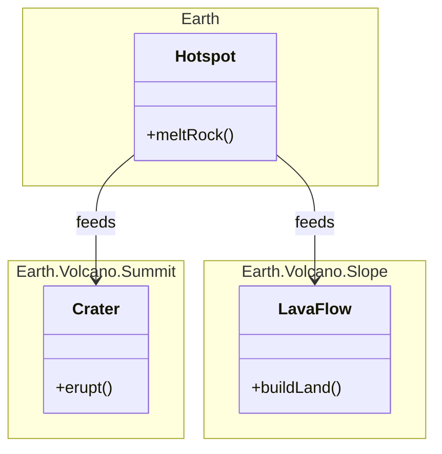
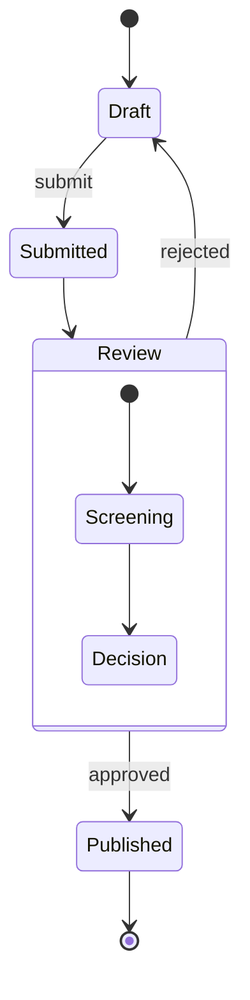

# Diagrams

Four examples from [Pele’s published gallery](https://pele.run/examples), rendered as native graphics. Open the full gallery for more diagram types.

## Flowchart

## Sequence

## Class

## State

