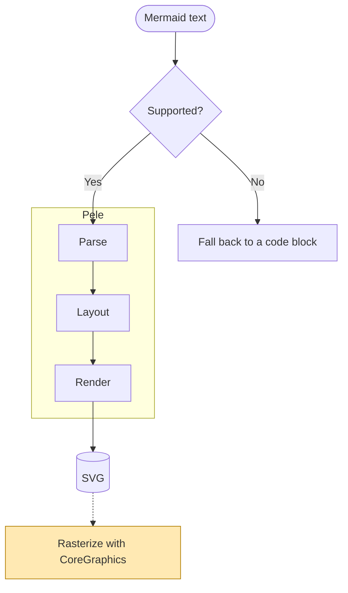
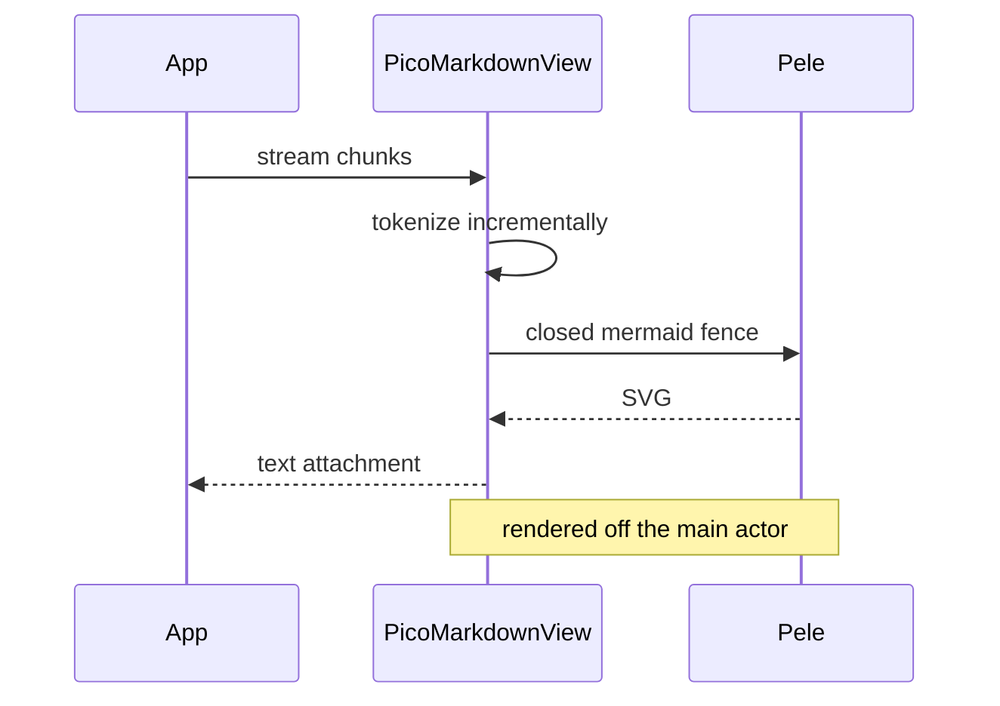
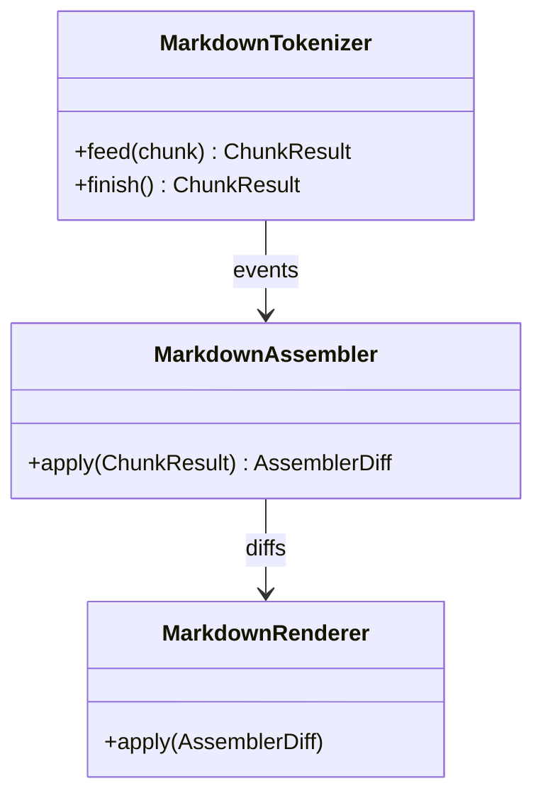
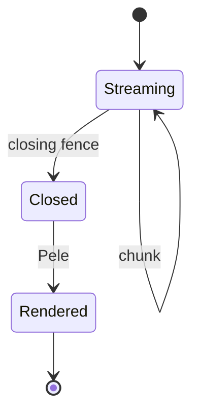
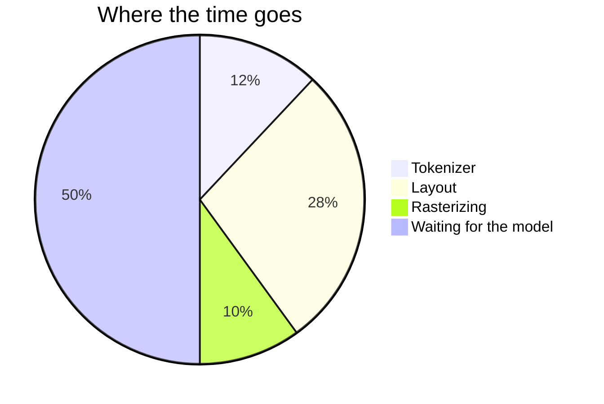
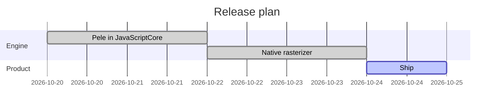
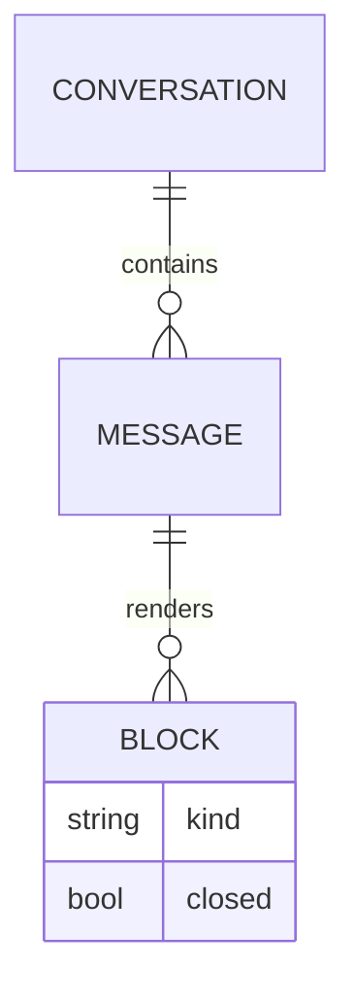
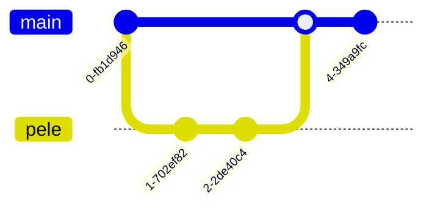
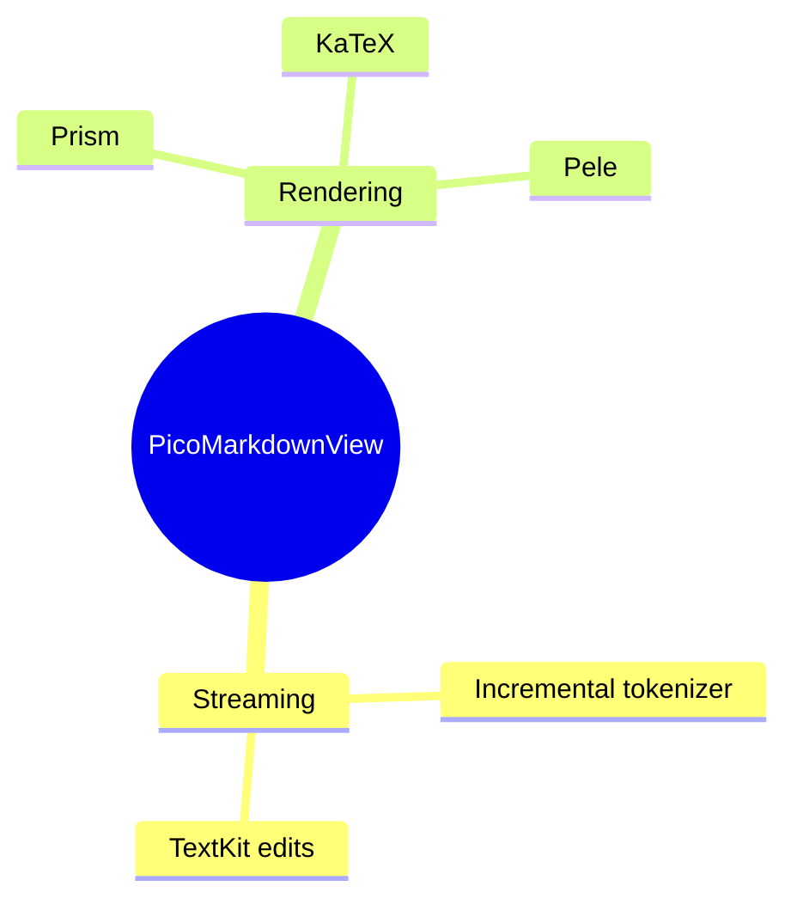
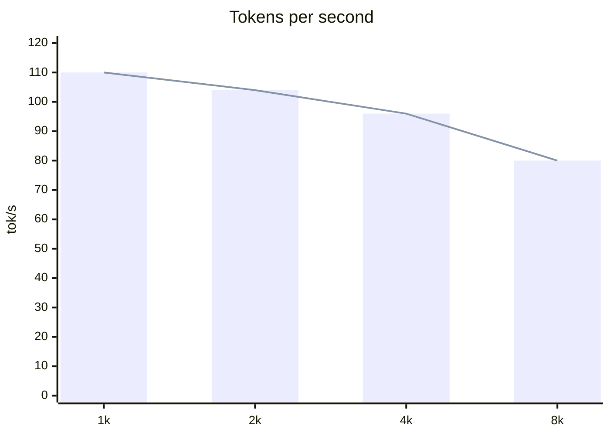

# Diagrams

Mermaid fences are laid out by [Pele](https://pele.run) and drawn natively. Every diagram type Mermaid 12.1 knows is available; a few of them:

## Flowchart



## Sequence



## Class



## State



## Pie



## Gantt



## ER



## Git graph



## Mindmap



## XY chart



## Not a diagram

A fence Pele cannot parse stays a code block:

```mermaid
this is not mermaid
```
