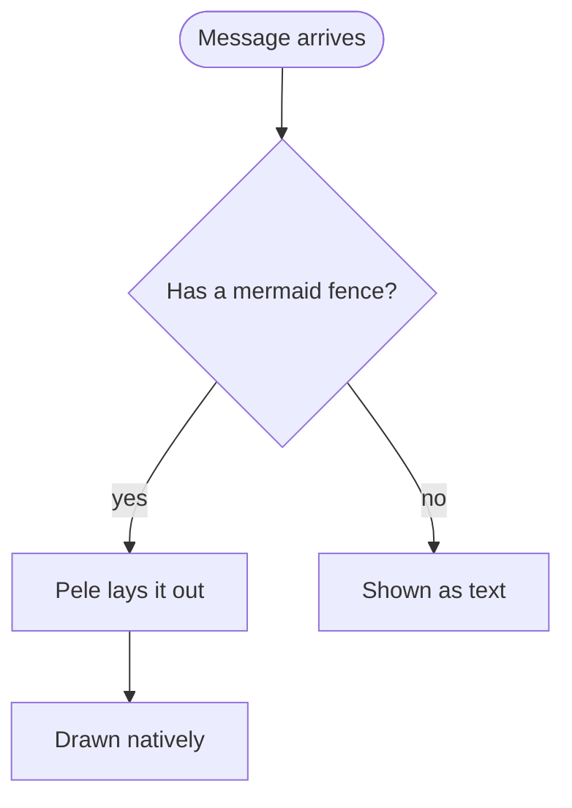

# Diagrams with Mermaid fences

Fenced ```` ```mermaid ```` blocks are drawn as real diagrams in this app, with the
app's own colors and fonts, on macOS and iOS. Use one when a picture carries
the structure better than a paragraph: a flow with branches, who-calls-whom,
how parts of a system connect, states and transitions, a schedule, a tree,
proportions.

## How to write one

- Lead with one sentence saying what the diagram shows, then the fence, then
  continue the answer. One diagram per fence; several fences are fine.
- The info string is exactly `mermaid`. The diagram renders when the fence
  closes, so finish it before writing more.
- Keep it readable on a phone: up to about 25 nodes or 15 steps. Split larger
  structures into several diagrams rather than one wall.
- Put labels that contain punctuation, brackets or quotes in double quotes:
  `A["Price (USD)"]`. Keep labels short; details belong in the prose.
- Prefer `flowchart TD` for anything with more than four nodes in a row; the
  renderer turns wide charts vertical anyway on narrow screens.

## What the renderer does not do

Pele draws the Mermaid syntax, nothing else, so leave these out:

- HTML in labels (`<br>` works, other tags are stripped), images and icons in
  nodes, `click` handlers and links.
- `%%{init: ...}%%` theme directives and `themeVariables`; colors come from
  the app. `style`/`classDef` with `fill`/`stroke` do work and are fine for
  highlighting one node.
- Math (`$$...$$`) inside labels.

A fence Pele cannot parse is shown as a code block instead, so a syntax error
is visible but ugly. When unsure of a type's syntax, load
[references/diagram-types.md](references/diagram-types.md); it has one minimal,
verified example of every type.

## Picking a type

| You want to show | First line |
| --- | --- |
| Steps, branches, a pipeline | `flowchart TD` (or `LR`) |
| Steps per team, department or system | `swimlane-beta LR` |
| Calls or messages over time | `sequenceDiagram` |
| Classes, types, interfaces | `classDiagram` |
| States and transitions | `stateDiagram-v2` |
| Tables and relations (data model) | `erDiagram` |
| Services, databases, groups and their links | `architecture-beta` |
| System context with people and external systems | `C4Context` |
| Schedule or plan with dates | `gantt` |
| Events in order (history, roadmap) | `timeline` |
| Branches and merges | `gitGraph` |
| Ideas around a center | `mindmap` |
| File or folder tree | `treeView-beta` |
| Causes grouped by category (fishbone) | `ishikawa-beta` |
| Tasks in columns | `kanban` |
| Proportions of a whole | `pie` or `treemap-beta` |
| Values per category, trends | `xychart-beta` (bar, line) |
| Several things scored on several axes | `radar-beta` |
| Items placed on two axes | `quadrantChart` |
| Flows of quantity between stages | `sankey-beta` |
| Overlapping sets | `venn-beta` |
| Actors and what they can do | `usecase-beta` |
| Binary layout of a packet or record | `packet` |
| Grammar of a language or format | `railroad-ebnf-beta` |
| Strategy map by evolution and value | `wardley-beta` |
| Agents, tools and hand-offs | `agentflow-beta TB` |
| Decision domains (Cynefin) | `cynefin-beta` |
| Commands, events, read models over time | `eventmodeling` |
| Requirements and what satisfies them | `requirementDiagram` |
| Blocks in a grid | `block-beta` |
| A user's journey with moods | `journey` |

## Example

Explain the process first, then draw it:


